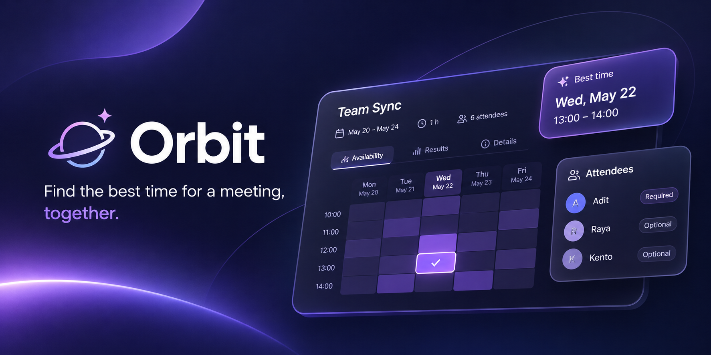

# Orbit

Orbit is a meeting scheduling platform designed to help groups find a time that works for everyone.

Create a meeting, invite people to participate, and let everyone share their availability. Orbit analyzes the responses, identifies overlapping free time, and suggests the best slots — making scheduling easier and reducing the endless back-and-forth of finding a suitable time.

Built around **workspaces**, Orbit supports everything from personal scheduling to team collaboration. Every user gets a personal workspace by default, with the ability to create or join additional team workspaces.

### Features

- **Workspaces** — Personal and team workspaces to organize meetings and members.
- **Flexible Scheduling** — Choose between voting on proposed time slots or marking availability on a calendar grid.
- **Smart Suggestions** — Find the best meeting times based on everyone's availability.
- **Attendee Priorities** — Distinguish between required and optional attendees when evaluating suitable times.
- **Timezone Support** — View meeting times in your local timezone, wherever you are.
- **Availability Profiles** — Set recurring availability to make future scheduling easier.
- **Meeting Management** — Create, edit, duplicate, reschedule, and manage meetings.
- **Reminders & Notifications** — Stay informed about confirmed meetings and upcoming schedules.

### Tech Stack

#### Frontend

#### Backend

#### Database & ORM

**Orbit is currently in development.**

Join the community and follow along as the project takes shape.

